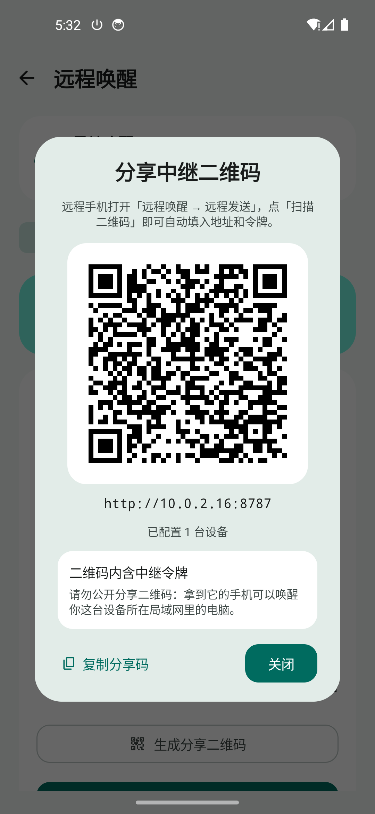
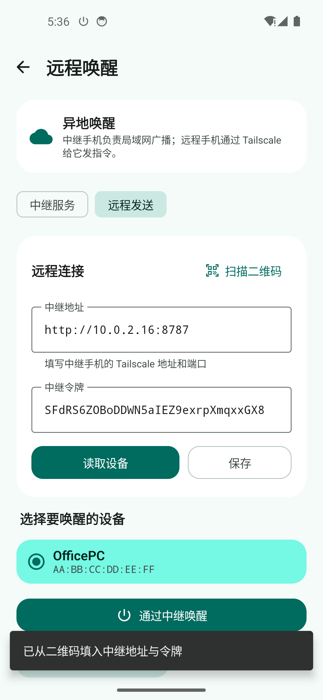

# WOL 唤醒（Wake-on-LAN）

一个 Android 局域网唤醒工具：配置目标设备的 MAC 地址和广播地址后，可在应用内一键唤醒，也可以把设备添加到桌面小组件，**点按小组件即可直接发送魔术包，无需先打开 App**。借助 Tailscale 中继，还能从外网远程唤醒——中继配置完成后**生成二维码**，远程手机**扫码即可自动填入地址和令牌**。

## 功能

- **设备配置**：设备名称、MAC 地址、广播地址、UDP 端口、发送次数（1–10 次拖拽条）。
- **MAC 掩码输入**：每输入两位十六进制自动补冒号，支持直接粘贴完整 MAC。
- **一键唤醒**：主界面按设备展示，点按「唤醒」立即发送 Wake-on-LAN 魔术包。
- **智能填充**：自动读取当前 Wi-Fi / 有线网络的 IPv4 地址和前缀，推导子网广播地址。
- **发送前测试**：编辑页可直接发送测试魔术包，无需保存。
- **桌面小组件**：2×1 尺寸，添加时选择设备，之后点按直接唤醒并显示结果。
- **远程唤醒（Tailscale 中继）**：一台手机在家里做中继，另一台手机在外网通过 Tailscale 发指令。
- **二维码分享中继**：中继页生成二维码，远程页扫码后自动填入中继地址与令牌并读取设备；没有相机权限或只有截图时，可从系统相册导入二维码。
- **Material 3 Expressive 界面**：官方 `MotionScheme.expressive()` 动效、折叠标题栏、变形 `LoadingIndicator` 与波浪进度条、主题色圆形转场与预测式返回。
- **无广告、无需登录、无需目标设备安装软件**。

## 截图

| 设备列表 | 添加设备 |
| --- | --- |
|  |  |

| 生成分享二维码 | 扫码自动填入 |
| --- | --- |
|  |  |

> 截图来自 Android 14（API 34）模拟器。其余功能截图保留在 `docs/screenshots/`。

## 环境要求

- Android 8.0（API 26）及以上，手机与目标设备处于同一局域网。
- 目标设备：BIOS/UEFI 已开启 Wake-on-LAN，网卡启用「Wake on Magic Packet」，建议有线连接并在关机后保持网卡供电（Windows 关闭「快速启动」）。
- 扫码需要相机权限；没有相机时可用「从相册选择二维码」，不需要存储权限。

## 构建

需要 JDK 17 和 Android SDK（compileSdk 37）。项目自带 Gradle Wrapper（9.3.1，指向国内镜像），首次构建前先装平台包：

```bash
sdkmanager "platforms;android-37.0" "build-tools;37.0.0"
./gradlew :app:assembleDebug        # 产物 app/build/outputs/apk/debug/app-debug.apk
./gradlew :app:testDebugUnitTest    # 单元测试
adb install -r dist/WolTool-debug.apk
```

`dist/`、APK 与构建日志已在 `.gitignore` 中排除，仓库只提交源码与文档。

技术栈：Kotlin 2.4.21、Jetpack Compose 1.12（BOM 2026.09.00）、Material 3 1.5.0-rc01、CameraX 1.6.2、ZXing core 3.5.4（二维码生成与解码，纯本地无 Google 服务依赖）、AGP 9.1.1、Gradle 9.3.1；`minSdk 26` / `targetSdk 36` / `compileSdk 37`。

## 使用

### 添加设备

1. 点「添加设备」，填写设备名称与 MAC（支持 `AA:BB:CC:DD:EE:FF`、`AA-BB-...`、`AABB...`）。
2. 广播地址点「自动」按当前网络填入，端口默认 `9`；拖动「发送次数」选择 1–10 次（默认 3 次）。
3. 点「发送测试魔术包」验证，成功即保存。
4. 点按设备卡片可编辑；**长按卡片**弹出删除确认框，确认后删除（已绑定的桌面小组件会显示「设备已删除」）。

### 桌面小组件

长按桌面 →「小组件」→ 找到「WOL 唤醒」→ 拖出 2×1 小组件 → 选择设备 →「添加到桌面」。之后直接点按即可唤醒，无需打开 App。

## 远程唤醒（Tailscale 中继）

Wake-on-LAN 是二层广播，**不能直接跨 Tailscale 或互联网发送**，因此用两台手机中继：

```text
远程手机  --Tailscale 100.x-->  中继手机  --UDP 广播-->  目标电脑
(外网)                         (家里的局域网)          (同一局域网/有线)
```

### 配置步骤

1. 两台手机安装 Tailscale 并登录同一个 tailnet。
2. 中继手机：「远程唤醒」→「中继服务」→ 打开中继开关，授予通知权限。
3. 中继手机点「生成分享二维码」（也可「复制分享码」发文本）。
4. 远程手机：「远程唤醒」→「远程发送」→「扫描二维码」对准二维码，识别后自动填入地址与令牌并读取设备；也可手动填写 `http://100.x.x.x:8787` 和令牌。
5. 选择设备，点「通过中继唤醒」。

中继手机需保持充电、联网，建议把 App 与 Tailscale 的省电策略设为「无限制」。

### 分享码格式

二维码内容是一段纯文本：`woltool://relay?v=1&u=<地址>&t=<令牌>[&n=<备注>]`（值做百分号编码，`+` 统一为 `%20`）。解析容忍大小写、参数顺序、未知参数、缺少 `v`；地址非法、令牌短于 8 位或版本不支持时给出中文提示。**分享码内含令牌，请勿公开发布。**

### HTTP API

除健康检查外都需要 `Authorization: Bearer <token>`：

```bash
curl http://100.x.x.x:8787/health
curl -H "Authorization: Bearer <token>" http://100.x.x.x:8787/api/devices
curl -X POST -H "Authorization: Bearer <token>" -H "Content-Type: application/json" \
  -d '{"deviceId":"<device-id>"}' http://100.x.x.x:8787/api/wake
```

### 安全与网络

- 中继监听 `0.0.0.0:8787`，仅靠令牌鉴权；**不要映射到公网**，只在 tailnet 内使用，可用 Tailscale ACL 限制端口。
- 中继发送 WOL 时会绑定 Wi-Fi/以太网 Network，避免 Exit Node 把广播带进隧道。
- 中继是前台服务；若仍被杀后台，需关闭电池优化并允许自启动。

## 实现说明

- **魔术包**：6 字节 `0xFF` + MAC 重复 16 次（102 字节），通过 `DatagramSocket` UDP 广播，默认连发 3 次。
- **小组件**：`PendingIntent` → `BroadcastReceiver` 后台直发，`goAsync()` + 超时保护；绑定按实例 ID 隔离，删除设备后降级提示并支持重选；绑定信息不参与云备份。
- **存储**：设备配置存 `SharedPreferences`（JSON），解析失败时保留原始数据备份。
- **中继**：前台服务 + 轻量 HTTP 服务（`/health`、`/api/devices`、`/api/wake`），令牌鉴权。
- **二维码生成**：ZXing `QRCodeWriter`（M 级纠错）出逐模块矩阵，按「整数像素模块 + 2 模块静区」铺成位图，白底黑码不随主题反色；只对已保存的中继配置生成，没有 Tailscale 地址时退回局域网 IPv4。
- **扫码**：CameraX `PreviewView` + `ImageAnalysis`（`KEEP_ONLY_LATEST`），按 `rowStride`/`pixelStride` 复制 Y 平面交给 ZXing `QRCodeReader`，自行处理 90/180/270 度旋转，成功后只回调一次并解绑相机。权限被永久拒绝可去设置，无后置相机回退前置，相机不可用时可用系统照片选择器导入图片（长边压到 2000px 内解码）。
- **界面**：`MaterialExpressiveTheme` + `MotionScheme.expressive()`；「添加设备」用主题色圆形转场，其它入口 320ms 滑入 + 缩放；`PredictiveBackHandler` 实现预测式返回（Android 12 及以下回退普通返回）。
- **注意**：material3 1.5 的 `Slider(state = ...)` 是受控组件，`onValueChange` 里必须写回 `state.value`。

## 权限

| 权限 | 用途 |
| --- | --- |
| `INTERNET` | 发送 UDP 魔术包；远程模式访问中继 API |
| `ACCESS_NETWORK_STATE` | 读取网络类型与 IPv4，计算广播地址并绑定局域网 |
| `POST_NOTIFICATIONS` | 中继前台服务常驻通知（Android 13+） |
| `FOREGROUND_SERVICE` / `FOREGROUND_SERVICE_SPECIAL_USE` | 保持中继服务后台运行 |
| `CAMERA` | 扫描中继二维码（仅扫码页按需申请，画面本地处理不上传） |

App 不申请位置、存储等敏感权限，也不含任何分析或广告 SDK。

## 项目结构

```
app/src/main/java/com/qianshi/woltool/
├── MainActivity.kt              # 入口与页面切换
├── WolViewModel.kt              # 唤醒状态与消息
├── data/                        # Device 模型、SharedPreferences 存储
├── wol/                         # 魔术包、UDP 发送、网络/广播地址
├── remote/
│   ├── RelayService.kt          # 中继前台服务
│   ├── RelayManager.kt          # 中继生命周期
│   ├── RelayHttpServer.kt       # 轻量 HTTP 服务
│   ├── RemoteClient.kt          # 远程端 HTTP 客户端
│   ├── RemoteSettings.kt        # 端口 / 令牌配置
│   ├── RelayShare.kt            # 分享码编解码（woltool://relay v1）
│   ├── QrCode.kt                # ZXing 生成二维码矩阵（纯 JVM）
│   └── QrDecoder.kt             # 二维码解码（灰度 / 像素 / 位图）
├── ui/
│   ├── DeviceListScreen.kt      # 设备列表
│   ├── DeviceEditorScreen.kt    # 添加 / 编辑 / 测试
│   ├── WidgetConfigScreen.kt    # 小组件配置
│   ├── RemoteScreen.kt          # 中继 / 远程发送
│   ├── RelayShareDialog.kt      # 分享二维码对话框
│   ├── QrCodeImage.kt           # 二维码渲染
│   ├── QrScannerScreen.kt       # 相机扫码 / 相册导入 / 权限兜底
│   └── theme/                   # Material 3 Expressive 主题
└── widget/                      # 小组件 Provider 与配置页
```

资源：`res/xml/wol_widget_info.xml`（小组件声明）、`res/layout/wol_widget.xml`（2×1 布局）、`res/xml/backup_rules.xml` / `data_extraction_rules.xml`（排除小组件绑定）。

## 常见问题

**发送成功但没唤醒？** 协议只负责把包发到局域网。检查 BIOS 网络唤醒、网卡「Wake on Magic Packet」、是否有线、Windows 快速启动、路由器 AP 隔离与 UDP 广播策略。可用 `tools/wol-listen.ps1 -Port 9` 或 Wireshark（`udp.port == 9`）确认收到 102 字节魔术包。

**广播地址填什么？** 如手机 `192.168.1.23/24` 填 `192.168.1.255`，编辑页点「自动」即可；部分路由器拦截 `255.255.255.255`，建议用子网定向广播。

**换 Wi-Fi / 子网后失败？** 广播地址是保存时的值，编辑设备点「自动」重新计算；手机与目标设备需在同一局域网。

**远程手机连不上中继？** 检查是否同一 tailnet、中继开关、地址是否为 `100.x`、端口与令牌是否一致、ACL 是否放行；可先用 `curl http://100.x.x.x:8787/health` 验证。

**扫不出二维码？** 让二维码完整落在取景框内、保持纯白底黑码，距离 10–20cm；仍不识别就点「从相册选择」，选二维码原图。

**扫码提示「这不是 WOL 中继二维码」/「令牌无效」？** 二维码不是本应用生成，或中继令牌已重新生成，让中继重新生成二维码即可。

**中继运行一段时间后失效？** Android 会限制后台服务，需关闭电池优化、允许自启动，并保持充电与联网。

## 验证情况

- `:app:testDebugUnitTest`：45 个单元测试通过（魔术包、MAC 解析、网络地址、远程 URL 规范化、分享码编解码 19 个、二维码解码 10 个含 90/180/270 度旋转）；`:app:assembleDebug`、`:app:lintDebug` 通过。
- Android 14 模拟器端到端实测：添加/编辑/删除设备、主界面唤醒、小组件冷启动发送、中继 `/health` + `/api/devices` + `/api/wake`、预测式返回与转场动画。
- 二维码实测：中继页生成二维码 → 导入相册 → 远程页扫码 → 自动填入地址与令牌并读取设备 → 通过中继唤醒成功；相机取景、权限页、返回键关闭扫码页、关闭后相机释放均正常。
- 未验证项：真实手机「拍另一台手机屏幕」的实时扫码未实机测试（模拟器无拍摄条件），解码逻辑与相册导入共用同一实现。
