# WOL 唤醒（Wake-on-LAN）

一个 Android 局域网唤醒工具：配置目标设备的 MAC 地址和广播地址后，可在应用内一键唤醒，也可以把设备添加到桌面小组件，**点按小组件即可直接发送魔术包，无需先打开 App**；借助 Tailscale 中继，还能从外网远程唤醒。

## 功能

- **设备配置**：设备名称、MAC 地址、广播地址、UDP 端口、发送次数（1–10 次拖拽条）。
- **MAC 掩码输入**：每输入两位十六进制自动补冒号，支持直接粘贴完整 MAC，并实时显示已输入位数。
- **一键唤醒**：主界面按设备展示，点按「唤醒」立即发送 Wake-on-LAN 魔术包。
- **Material 3 Expressive 界面**：页面进入 / 退出使用官方 `MotionScheme.expressive()` 动效规格；列表用会随滚动折叠的 `LargeFlexibleTopAppBar`；发送次数是官方 M3 拖拽条（刻度吸附 + 手柄按压拉伸）；发送时用变形 `LoadingIndicator` 与波浪 `LinearWavyProgressIndicator`；列表增删有过渡动画。
- **页面进入与预测式返回动效**：点击「添加设备」时按钮作为共享容器，从按钮边界扩展到全屏，圆角逐渐收拢、按钮文案淡出、背景色过渡，新页面内容随后淡入；Android 13+ 拖动返回手势时页面实时缩小并显示圆角，下层设备列表从四周露出；松手完成返回，取消手势恢复。Android 12 及以下自动回退为普通返回。
- **智能填充**：自动读取当前 Wi-Fi / 有线网络的 IPv4 地址和前缀，推导子网广播地址（如 `192.168.1.255`）。
- **发送前测试**：在编辑页直接发送测试魔术包，无需保存即可验证配置。
- **桌面小组件**：2×1 尺寸，可在添加时选择设备；之后点按小组件直接唤醒，并显示发送结果与时间。
- **远程唤醒（Tailscale 中继）**：一台手机在家里做中继，另一台手机在外网通过 Tailscale 发指令，由中继在局域网广播魔术包。
- **无广告、无需登录、无需目标设备安装软件**。

## 截图

| 空状态 | 设备列表 |
| --- | --- |
| 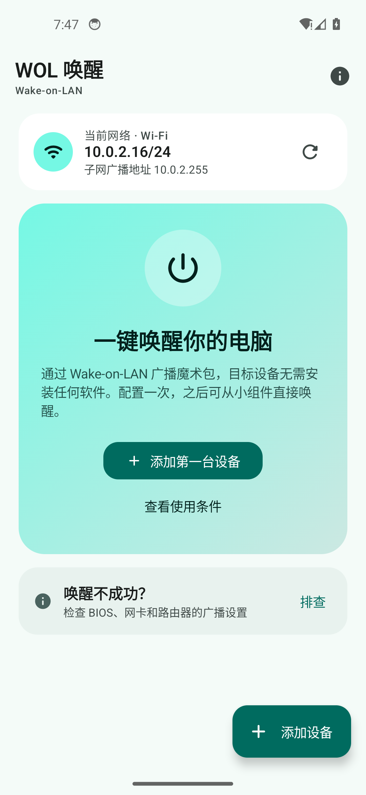 | 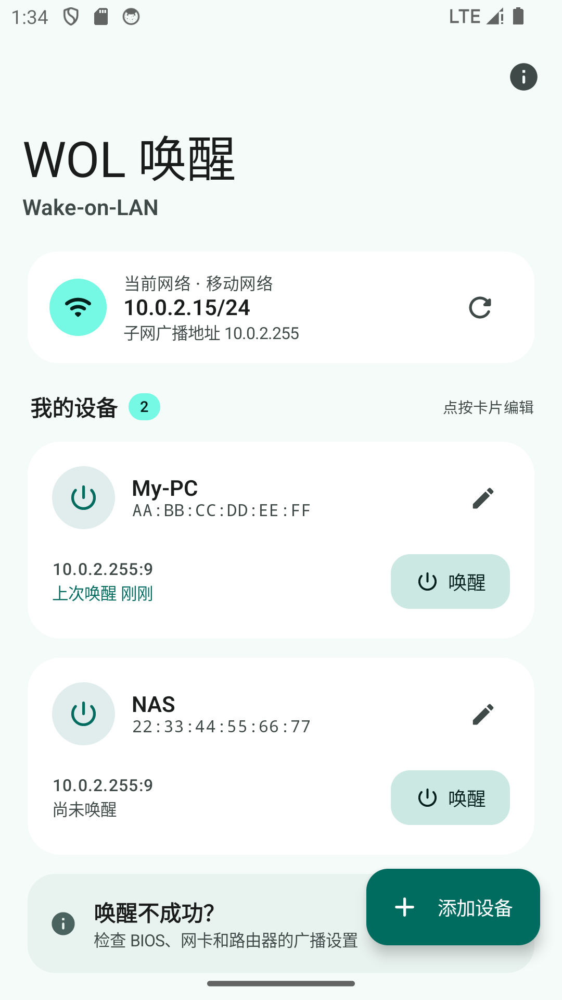 |

| 添加 / 编辑设备 | 唤醒结果 |
| --- | --- |
| 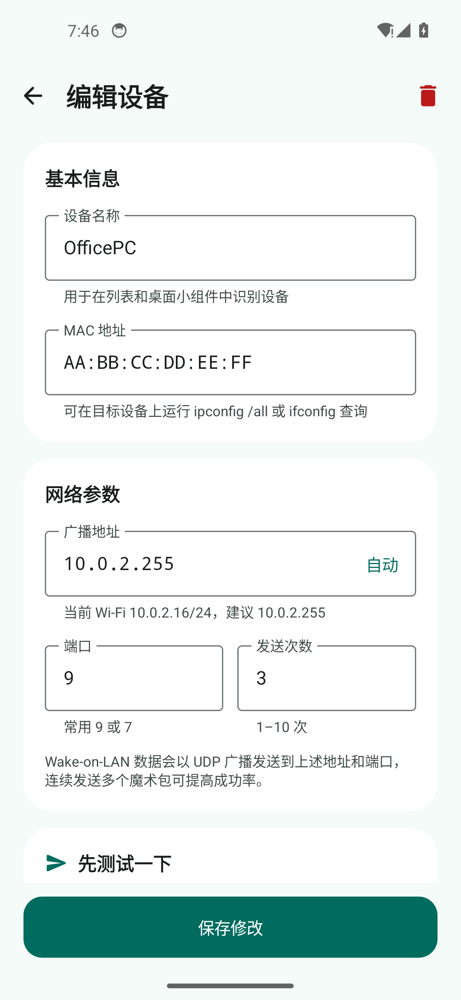 | 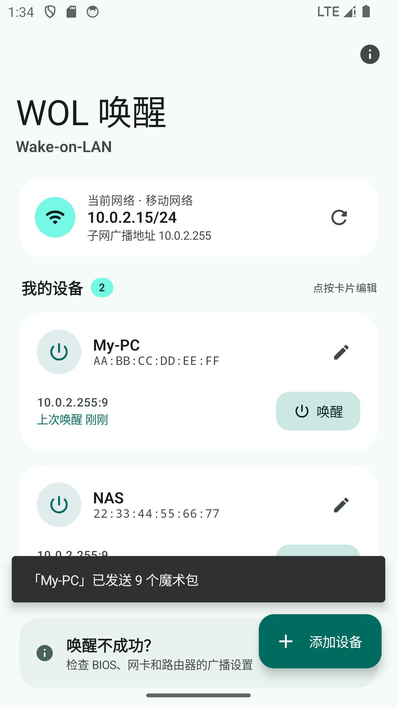 |

| MAC 自动分隔 | 输入完成 |
| --- | --- |
| 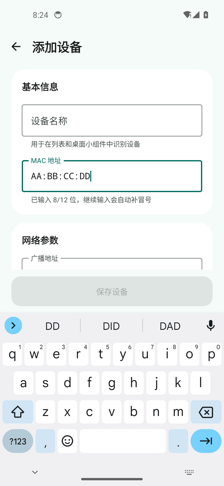 | 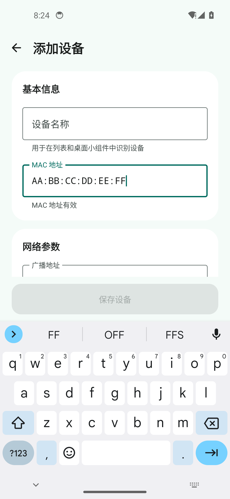 |

| 发送次数拖拽条 | 发送中的变形加载与波浪进度 |
| --- | --- |
| 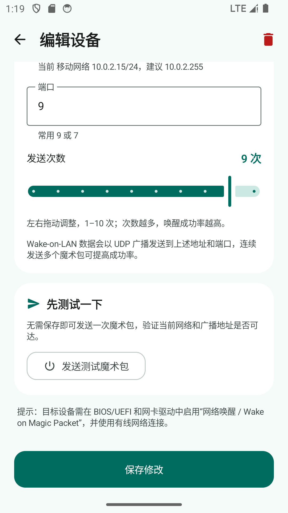 | 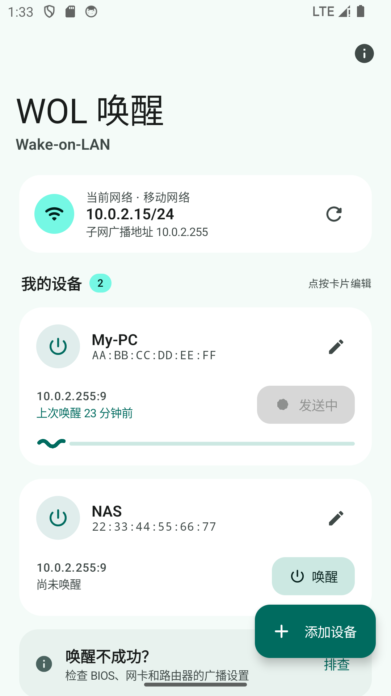 |

| 桌面小组件 | 点按小组件直接唤醒 |
| --- | --- |
|  | 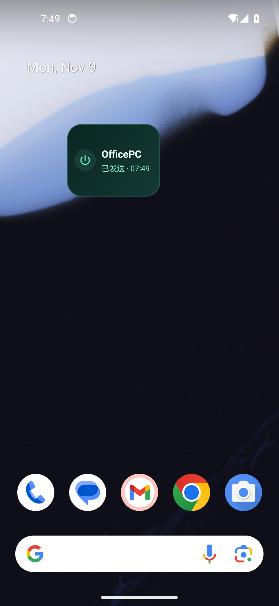 |

| 中继服务 | 远程发送 |
| --- | --- |
| 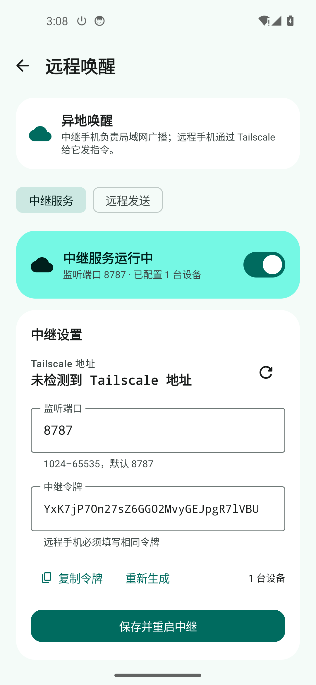 | 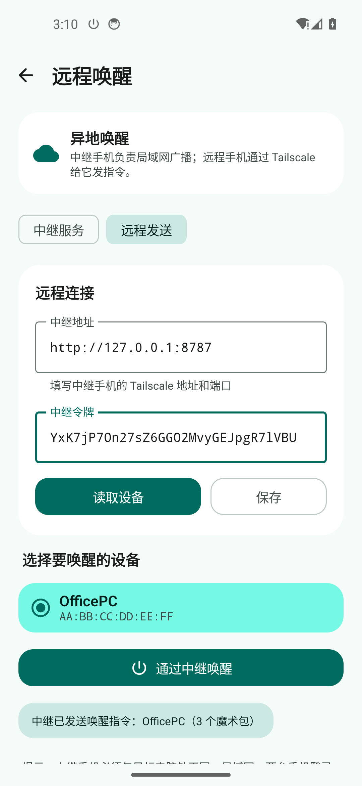 |

| 按钮共享容器展开 | 预测式返回 |
| --- | --- |
| 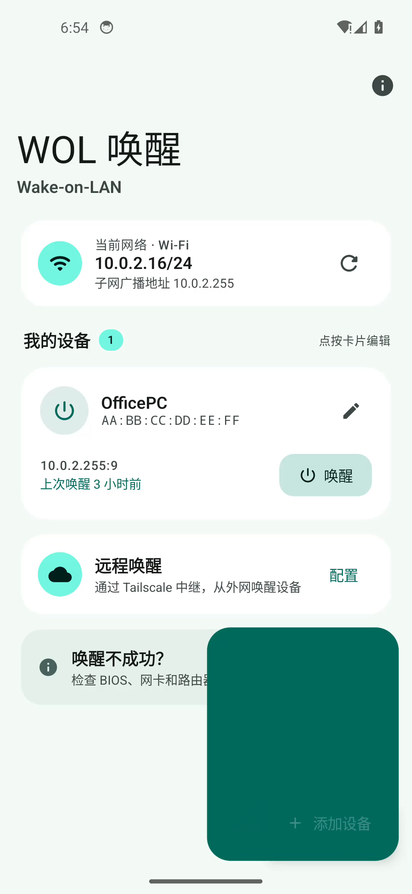 | 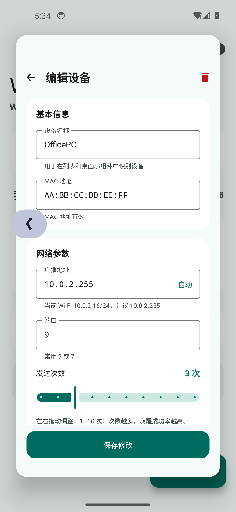 |

> 截图来自 Android 14（API 34）模拟器，2×1 小组件的点击发送已实际验证（无需打开 App）。远程发送截图中使用本机回环地址做端到端测试，实际使用时填写中继手机的 Tailscale 地址。

## 环境要求

- Android 8.0（API 26）及以上
- 手机与目标设备处于同一局域网
- 目标设备：
  - 主板 BIOS/UEFI 已开启 Wake-on-LAN / Power On By PCI-E
  - 网卡驱动已启用 “Wake on Magic Packet”
  - 使用有线网络连接
  - 关机后网卡保持供电（Windows 建议关闭「快速启动」）

## 构建

需要 JDK 17 和 Android SDK（compileSdk 37，即 Android 17）。项目自带 Gradle Wrapper（9.3.1，指向国内镜像）。首次构建前先装平台包：

```bash
sdkmanager "platforms;android-37.0" "build-tools;37.0.0"
```


```bash
./gradlew :app:assembleDebug
```

产物：`app/build/outputs/apk/debug/app-debug.apk`。本地也可以复制到 `dist/WolTool-debug.apk` 方便安装；`dist/`、APK 和构建日志已在 `.gitignore` 中排除，Git 仓库只提交源码与文档。

安装到已连接的设备 / 模拟器：

```bash
adb install -r dist/WolTool-debug.apk
```

运行单元测试：

```bash
./gradlew :app:testDebugUnitTest
```

技术栈：Kotlin 2.4.21（AGP 9 内置 Kotlin 支持）、Jetpack Compose 1.12（BOM 2026.09.00）、Material 3 1.5.0-rc01、AGP 9.1.1、Gradle 9.3.1；`compileSdk 37`（Android 17）/ `minSdk 26` / `targetSdk 36`。

## 使用

1. 打开 App，点按「添加设备」。
2. 填写设备名称与 MAC 地址（支持 `AA:BB:CC:DD:EE:FF`、`AA-BB-...`、`AABB...` 等格式）。
3. 广播地址通常点击「自动」即可填入当前子网广播地址；端口保持默认 `9`。
4. 左右拖动「发送次数」拖拽条选择 1–10 次（默认 3 次，次数越多成功率越高）。
5. 点按「发送测试魔术包」验证配置，成功后保存。
6. 在主界面点按设备卡片上的「唤醒」发送唤醒指令。

### 添加桌面小组件

1. 长按桌面空白处 →「小组件」。
2. 找到「WOL 唤醒」，把 2×1 小组件拖到桌面。
3. 在配置页选择设备（也可现场添加），点按「添加到桌面」。
4. 以后直接点按桌面上的小组件即可发送魔术包，无需打开 App。

> 长按已添加的小组件可重新配置；删除设备后，小组件会显示「设备已删除」，点按可重新选择设备。

## 远程唤醒（Tailscale 中继）

Wake-on-LAN 是二层广播，**不能直接跨 Tailscale 或互联网发送**。本项目采用两台手机的中继方案：

```text
远程手机  --Tailscale 100.x-->  中继手机  --UDP 广播-->  目标电脑
(外网)                         (家里的局域网)          (同一局域网/有线)
```

中继手机必须和目标电脑在同一局域网，远程手机只负责通过 Tailscale 给中继发 HTTP 指令。

### 配置步骤

1. 两台手机都安装 Tailscale，登录同一个 tailnet，并确认彼此可以访问。
2. 中继手机打开 App → 主界面「远程唤醒」→「中继服务」。
3. 打开中继开关，授予通知权限；页面会显示 Tailscale 地址、端口（默认 `8787`）和中继令牌。
4. 远程手机打开「远程唤醒」→「远程发送」，填写：
   - 中继地址：`http://100.x.x.x:8787`
   - 中继令牌：与中继手机显示的令牌一致
5. 点「读取设备」，选择设备，再点「通过中继唤醒」。

中继手机应保持充电、联网，建议把 App 与 Tailscale 的省电策略都设置为「无限制」，并允许 Tailscale 常驻后台。

### HTTP API

中继服务只开放三个接口，除健康检查外都需要令牌：

```bash
# 健康检查（无需令牌）
curl http://100.x.x.x:8787/health

# 读取中继上配置的设备
curl -H "Authorization: Bearer <token>" \
  http://100.x.x.x:8787/api/devices

# 唤醒指定设备
curl -X POST -H "Authorization: Bearer <token>" \
  -H "Content-Type: application/json" \
  -d '{"deviceId":"<device-id>"}' \
  http://100.x.x.x:8787/api/wake
```

### 安全与网络注意

- 中继服务监听 `0.0.0.0:8787`，依靠令牌鉴权；**不要把端口映射到公网**，只在 Tailscale tailnet 内使用。
- Tailscale 已对链路加密；HTTP 明文仅存在于 tailnet 内部。建议用 Tailscale ACL 只允许远程手机访问中继的 `8787` 端口。
- 如果 Tailscale 未连接，页面会显示「未检测到 Tailscale 地址」，打开 Tailscale 后点刷新。
- 中继手机发送 WOL 时会绑定 Wi-Fi/以太网 Network，避免 Tailscale 的 Exit Node 把广播包带进隧道。
- 中继是前台服务；如果系统仍然杀后台，需要关闭电池优化并允许自启动。

## 验证广播是否真的发出

### 方式一：电脑端监听脚本（无需安装软件）

电脑与手机连在同一个局域网，在项目目录运行：

```powershell
.\tools\wol-listen.ps1 -Port 9 -TimeoutSeconds 120
```

然后在手机上点一次「唤醒」。脚本会打印收到的 UDP 包并校验魔术包结构：

```text
[16:13:03.095] 192.168.153.146:58912  102 字节  有效 WOL 魔术包 MAC=00:D8:61:F8:A5:F9
  FF-FF-FF-FF-FF-FF-00-D8-61-F8-A5-F9-...(MAC 重复 16 次)
```

看到 `102 字节` 且 `有效 WOL 魔术包`，说明 App 确实通过局域网发出了标准的 Wake-on-LAN 广播包。

> 收不到时先检查：App 中配置的端口是否与脚本一致（默认 9）、电脑和手机是否在同一子网、Windows 防火墙是否允许入站 UDP。添加防火墙规则（管理员 PowerShell）：
>
> ```powershell
> New-NetFirewallRule -DisplayName "WOL UDP 9" -Direction Inbound -Protocol UDP -LocalPort 9 -Action Allow
> ```

### 方式二：Wireshark 图形化抓包

1. 安装 [Wireshark](https://www.wireshark.org/)（安装时一并安装 Npcap）。
2. 选择与手机同一局域网的网卡（如「以太网」），开始抓包。
3. 在过滤栏输入 `udp.port == 9`，然后在手机上点「唤醒」。
4. 应看到：源地址为手机 IP、目的地址为子网广播地址（如 `192.168.153.255`）、长度为 102 字节的 UDP 包；负载为 6 个 `FF` + MAC 重复 16 次。

## 预测式返回实现

- 主界面列表始终保留在底层；编辑页 / 远程页作为覆盖层，使用 `PredictiveBackHandler` 接收返回手势进度。
- 点击「添加设备」时记录按钮在根布局中的边界和文案；用一个全屏 `Canvas` 把按钮的圆角矩形从原边界插值扩展到全屏（约 420ms），圆角从按钮胶囊半径收拢为 0，背景色从主色过渡到页面背景色。
- 按钮文案在过渡开始后 30% 内淡出；新页面在底层预先布局，随容器接近全屏而淡入，最后撤掉共享容器，形成类似共享元素/容器变换的效果，页面内容不做缩放或变形。
- 覆盖层根据 `BackEventCompat.progress` 实时缩放（1.0 → 0.84）、增加圆角、阴影和暗色 scrim；底层列表保持全尺寸，因此会从四周露出。
- 松手完成时关闭覆盖层；取消手势时进度回到 0，页面恢复原状。
- Android 13+ 使用 `PredictiveBackHandler`；Android 12 及以下没有预测式返回 API，自动使用普通 `BackHandler` 直接返回。
- Manifest 已启用 `android:enableOnBackInvokedCallback="true"`。
- 编辑页在小组件配置流程中仍可独立处理返回（`handleSystemBack` 参数）。

## 实现说明

- 魔术包格式：6 字节 `0xFF` + 目标 MAC 重复 16 次，共 102 字节。
- 通过 `DatagramSocket` 以 UDP 广播发送到配置的广播地址与端口，默认连续发送 3 次以提高成功率。
- 小组件通过 `PendingIntent` → `BroadcastReceiver` 在后台直接发送；`goAsync()` + 超时保护保证进程在发送完成前不被回收，异常也不会导致宿主进程崩溃。
- 设备配置保存在 `SharedPreferences`（JSON），不依赖数据库；读取失败时保留原始数据备份，避免静默丢失。
- 小组件绑定按实例 ID 隔离，支持多个设备小组件；删除设备后小组件降级为「设备已删除」并提供点按重选入口。
- 小组件绑定信息不参与云备份，并在系统恢复后自动清空，避免 launcher 重新分配 ID 后唤醒错设备。
- 界面使用 Material 3 Expressive：`MaterialExpressiveTheme` + `MotionScheme.expressive()` 提供官方弹性按压、形变与过渡曲线；页面切换用 `AnimatedContent` 套用 `MaterialTheme.motionScheme` 的 `defaultSpatialSpec` / `fastSpatialSpec` 与对应 effects spec；发送次数直接用官方 `Slider`（`rememberSliderState` + 9 个刻度），手柄与轨道动效由组件自带。
- 其余组件同样走官方 Expressive 动效：列表标题用 `LargeFlexibleTopAppBar` + `exitUntilCollapsedScrollBehavior`（随滚动收缩），发送中的按钮用 `LoadingIndicator`（多边形形变），设备卡片里叠加 `LinearWavyProgressIndicator`（波浪进度）。
- 注意：material3 1.5 的 `Slider(state = ...)` 是**受控**组件，`onValueChange` 里必须把值写回 `state.value`（组件自己不会改 state），否则会出现「数字变了但手柄/进度不动」的现象。

## 权限

| 权限 | 用途 |
| --- | --- |
| `INTERNET` | 发送 UDP 魔术包；远程模式访问中继 HTTP API |
| `ACCESS_NETWORK_STATE` | 读取当前网络类型与 IPv4 信息，计算子网广播地址，绑定 Wi-Fi/以太网 |
| `POST_NOTIFICATIONS` | 中继前台服务的常驻通知（Android 13+ 会弹出授权） |
| `FOREGROUND_SERVICE` / `FOREGROUND_SERVICE_SPECIAL_USE` | 保持中继 HTTP 服务在后台运行 |

均为普通权限；通知权限需要用户确认。App 不申请位置、存储、相机等敏感权限，也不包含任何分析或广告 SDK。

## 项目结构

```
app/src/main/java/com/qianshi/woltool/
├── MainActivity.kt              # 入口与页面切换
├── WolViewModel.kt              # 唤醒状态与消息
├── data/
│   ├── Device.kt                # 设备模型
│   └── DeviceRepository.kt      # SharedPreferences JSON 存储
├── wol/
│   ├── WolPacket.kt             # MAC 解析与魔术包构造
│   ├── WolSender.kt             # UDP 广播发送
│   └── NetworkUtils.kt          # 本机 IPv4 / 子网广播地址计算
├── ui/
│   ├── DeviceListScreen.kt      # 设备列表
│   ├── DeviceEditorScreen.kt    # 添加 / 编辑 / 测试
│   ├── WidgetConfigScreen.kt    # 小组件配置页
│   ├── RemoteScreen.kt          # 中继 / 远程发送界面
│   ├── WakeHelpDialog.kt        # 使用条件与排查
│   └── theme/                   # Material 3 Expressive 主题
├── remote/
│   ├── RelayService.kt          # 中继前台服务
│   ├── RelayManager.kt          # 中继服务生命周期
│   ├── RelayHttpServer.kt       # 轻量 HTTP 服务与 WOL 触发
│   ├── RemoteClient.kt          # 远程端 HTTP 客户端
│   └── RemoteSettings.kt        # 端口 / 令牌配置
└── widget/
    ├── WolWidgetProvider.kt     # 小组件点击发送与状态刷新
    └── WidgetConfigActivity.kt  # 小组件选择设备
```

资源文件：`res/xml/wol_widget_info.xml`（小组件声明）、`res/layout/wol_widget.xml`（2×1 布局）、`res/xml/backup_rules.xml` 与 `data_extraction_rules.xml`（排除小组件绑定）。

## 常见问题

**发送成功但没有唤醒？**
协议只负责把魔术包发到局域网，能否唤醒取决于目标设备。依次检查：BIOS 网络唤醒选项、网卡「Wake on Magic Packet」、是否使用有线网络、Windows 快速启动、路由器 AP 隔离与 UDP 广播策略。

**子网广播地址填什么？**
例如手机 IP 为 `192.168.1.23/24`，广播地址填 `192.168.1.255`。编辑页点「自动」会按当前网络计算。部分路由器会拦截 `255.255.255.255`，建议使用子网定向广播地址。

**小组件点按没反应？**
确认小组件已绑定设备（显示设备名称而不是「点按配置」），并检查是否被系统省电策略限制后台广播。可在系统设置中允许本应用后台运行。

**换了一个 Wi-Fi / 子网后唤醒失败？**
广播地址是配置时保存的。编辑设备，点「自动」按当前网络重新生成子网广播地址；手机与目标设备必须处于同一局域网，VPN 可能会改变路由。远程模式发送时，中继会自动绑定 Wi-Fi/以太网 Network。

**远程手机连不上中继？**
依次检查：两台手机是否登录同一个 Tailscale 账号 / tailnet；中继开关是否打开；地址是否为中继的 `100.x` Tailscale IP；端口和令牌是否一致；Tailscale ACL 是否允许访问该端口。可以先用 `curl http://100.x.x.x:8787/health` 验证连通性。

**中继运行一段时间后失效？**
Android 会限制后台服务。请给中继 App 和 Tailscale 关闭电池优化、允许自启动；中继手机需要保持充电和联网。中继服务使用前台通知常驻，但仍可能被部分厂商的省电策略终止。

## 验证情况

- `./gradlew :app:testDebugUnitTest`：16 个单元测试全部通过（魔术包结构、MAC 解析/掩码、IPv4/广播地址、Tailscale 地址、远程 URL 规范化）。
- `./gradlew :app:assembleDebug`：构建成功。
- Android 14（API 34）模拟器实测：添加 / 编辑 / 删除设备、主界面唤醒、小组件添加与选择设备、**强制停止 App 后点按小组件冷启动发送**、删除设备后小组件的降级提示与重新配置。
- 远程链路实测：中继 HTTP 服务启动后通过 `adb forward` 访问 `/health`、`/api/devices`、`/api/wake`，鉴权、设备列表和 3 个魔术包发送均正常；远程端 UI 读取中继设备并触发唤醒成功。
- 预测式返回实测（Android 14 / API 34）：长滑返回时编辑页缩小并露出下层列表；取消手势后编辑页恢复；三键导航下按返回键正常返回。添加设备页的进入过渡通过 30fps 录屏逐帧确认：按钮圆角容器从右下角展开为全屏、按钮文案淡出、页面随后淡入。Android 12 及以下的普通 `BackHandler` 分支已编译验证。
- Material 3 Expressive 改版同样在模拟器实测：拖拽发送次数 3 → 8 后保存 / 唤醒正常；页面进入与退出的位移动画（`MotionScheme` 规格）在 Android 14（API 34）与 Android 16（API 36）上均正常。
- Expressive 组件实测：拖动滑块时手柄与进度同步移动（3 → 9 保存为 `packetCount: 9`）；折叠标题栏在列表滚动时收缩；发送过程中抓到 `LoadingIndicator` 多边形形变与卡片底部波浪进度条；编辑页「发送测试魔术包」的发送中状态同样显示变形加载图标。
- 工具链已升级到 AGP 9.1.1 + Gradle 9.3.1 + compileSdk 37（Android 17）：`compileSdk 37` 只影响编译，`minSdk 26` / `targetSdk 36` 未变，Android 8.0–16 的机型仍可正常安装运行，Android 16 上已实测安装、启动、编辑、保存与唤醒全流程。
